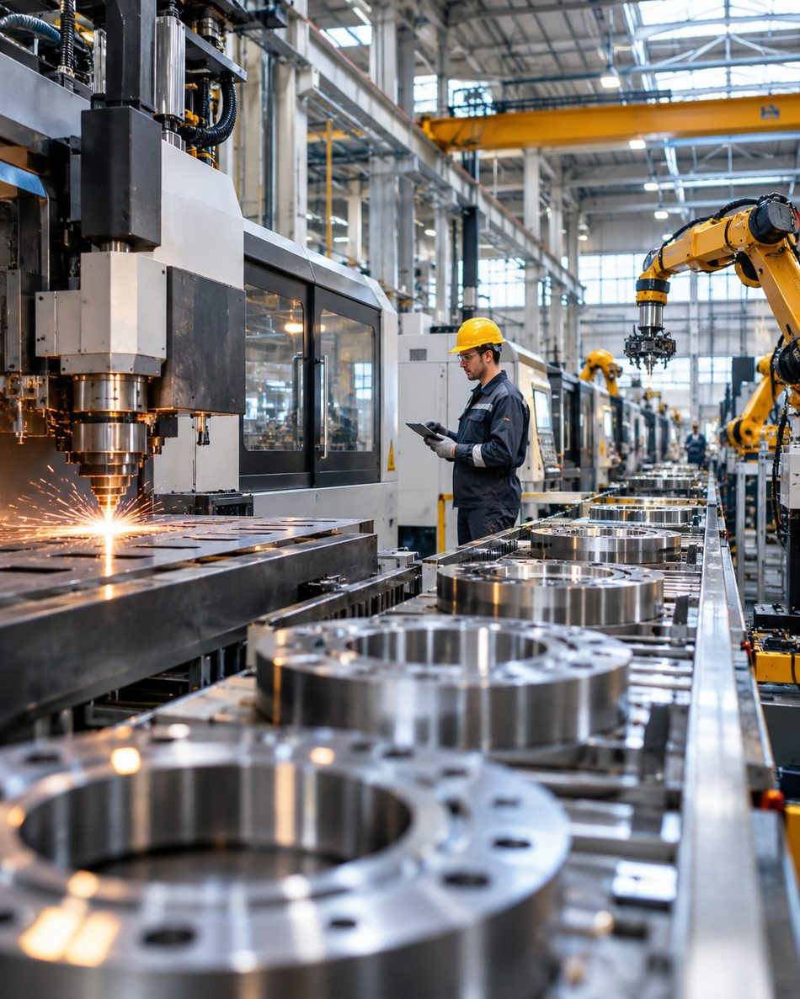

*Производство выросло на 30%. А прибыль способна даже уменьшиться. Показываем на цифрах — и объясняем, от чего зависит зарплата.*

---

# Завод производит на 30% больше. Почему зарплаты не обязаны расти?

Новый станок ускорил производство. Руководитель показывает красивый график: **плюс 30% деталей за тот же рабочий час**. Работники ждут прибавки. Но директор может одновременно говорить, что денег почти не прибавилось.

**Оба утверждения могут быть верны.** Выпуск на час труда — лишь первый шаг в цепочке, а не размер заработанного компанией выигрыша.

## Сначала проверьте, что именно выросло

Производительность труда в простейшем физическом измерении — количество произведённых единиц за час. Но для экономики важен и **стоимостной результат**: по какой цене удаётся продать продукцию и сколько ресурсов поглощает её производство.

Вот условный пример: завод выпускает стандартизированные детали, рабочие часы не меняются, а цена снижается из-за конкуренции. Переменные затраты на единицу остаются прежними.

| Показатель | До станка | После станка |
| --- | ---: | ---: |
| Деталей за период | 100 | 130 |
| Цена одной детали | 1 000 ₽ | 900 ₽ |
| Выручка | 100 000 ₽ | 117 000 ₽ |
| Переменные затраты, 600 ₽ за деталь | 60 000 ₽ | 78 000 ₽ |
| **Маржинальный доход до постоянных затрат** | **40 000 ₽** | **39 000 ₽** |

**Физический выпуск вырос на 30%, а маржинальный доход уменьшился на 2,5%.** И это ещё *до* дополнительных расходов на оборудование, проценты и амортизацию.

Это не означает, что модернизация бесполезна: она могла быть необходима, чтобы удержать клиентов или выжить при снижении рыночных цен. Но обещать повышение зарплаты исключительно по цифре выпуска — некорректно.

## Предположим, выигрыш действительно есть. Кто его получает?

Предприятие продаёт больше и зарабатывает больше после всех издержек. Тогда дополнительные средства могут пойти разным участникам:

- **Покупателям** — в виде более низких цен.
- **Работникам** — через оплату, обучение, безопасность труда и лучшие условия.
- **Инвесторам и кредиторам** — через доход на вложенный капитал и обслуживание финансирования.
- **Самому бизнесу** — через обновление оборудования, резерв и расширение производства.

Выбор зависит не только от личных качеств директора. Влияют рыночная конкуренция, дефицит кадров, возможность работника перейти к другому работодателю, договорённости о премировании, долги предприятия и цена нового оборудования.

## Почему «рынок труда решит» — неполный ответ

Допустим, предприятие — один из немногих крупных работодателей в городе. Работнику трудно сменить место, даже если он создаёт больше стоимости. Компания может дольше удерживать оплату на прежнем уровне. Там, где работодатели активно конкурируют за квалификацию, условия переговоров иные.

Это не универсальный закон о каждом заводе. Но [Международная организация труда в заявлении от 12 октября 2026 года](https://www.ilo.org/resource/statement/making-productivity-growth-work-people) выделяет концентрацию работодателей и слабые переговорные позиции работников среди факторов, мешающих широко распределять выгоды производительности. ILO также отмечает: на глобальном уровне этот выигрыш **не всегда устойчиво преобразуется в доходы работников**.

Важная оговорка: международный анализ не говорит, какую зарплату должен получать конкретный сотрудник в России. Для этого нужны данные по отрасли, региону и предприятию.

## Что измерять вместо единственной цифры «+30%»

Для предпринимателя и руководителя важна цепочка:

**Выпуск за час → выручка → маржинальный доход → прибыль после всех издержек → доступные средства на оплату и инвестиции.**

Для работника — другая:

**Изменение трудозатрат и обязанностей → реальная оплата за час → премии → безопасность и качество работы → альтернативы на рынке труда.**

Отдельно проверьте, не «куплен» ли прирост сокращением персонала, ростом неоплачиваемых переработок или ухудшением качества продукции. Час труда нужно считать одинаково *до* и *после*, а зарплату — с поправкой на инфляцию.

## Как вести предметный разговор о прибавке

Вместо абстрактного «завод стал эффективнее — платите больше» полезнее обсуждать **прозрачную формулу участия работников в измеримом результате**. Например, премию за дополнительную годную продукцию, *реально проданную* с положительным вкладом в покрытие затрат, при сохранении требований безопасности и качества.

Такая формула не отменяет переговоры о базовой оплате и не гарантирует прибавки. Зато связывает стимул с результатом, который предприятие действительно получило, а не с эффектным процентом в презентации.

> Технология увеличивает возможности производства. Кто получит выгоду — решается уже в экономике, конкуренции и договорённостях между людьми.

**Первоисточник:** [International Labour Organization — Making productivity growth work for people, 12.10.2026](https://www.ilo.org/resource/statement/making-productivity-growth-work-people).

*Данные о заводе и все рублёвые суммы вымышлены для объяснения механизма.*
