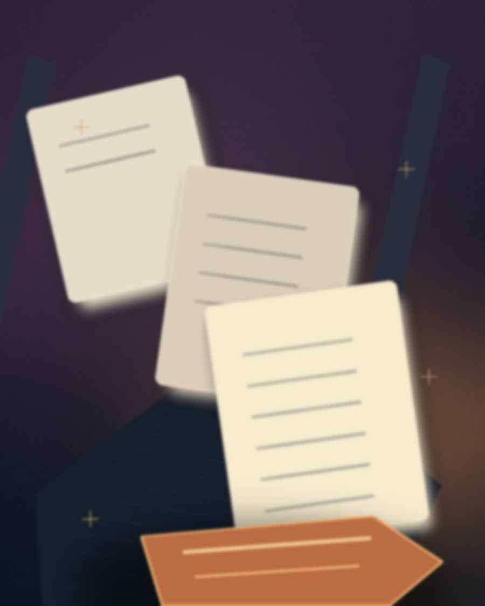

*Товар за 2 000 ₽ превращается в покупку за 2 400 ₽. Почему добавленная в конце комиссия меняет решение — и как сравнивать цены честно.*

---

# Цена на витрине — не цена на кассе

Сначала вы видите **2 000 ₽**. После выбора доставки и перехода к оплате — **2 400 ₽**. Дополнительные 400 рублей появились не потому, что товар стал лучше: они возникли в последовательности раскрытия цены.

Это пример механизма *drip pricing* — когда части обязательной цены показывают покупателю постепенно. Не каждая доплата незаконна и не всякая доставка должна быть бесплатной. Проблема возникает там, где человек принимает основное решение, ещё не зная итоговой суммы.

## Эксперимент на бумаге, не в лаборатории

Предположим, два магазина продают одинаковый товар, с одинаковой гарантией и сроками доставки. Все суммы вымышлены.

| Строка | Магазин А | Магазин Б |
| --- | ---: | ---: |
| Цена на карточке | 2 000 ₽ | 2 200 ₽ |
| Сервисный сбор | 250 ₽ | 0 ₽ |
| Доставка | 150 ₽ | 0 ₽ |
| **Итого к оплате** | **2 400 ₽** | **2 200 ₽** |

Покупатель, сравнивающий карточки, может выбрать А: на витрине он дешевле на 200 ₽. Но **итоговая покупка в А дороже на 200 ₽**, то есть примерно на **9,09% относительно полной цены Б**.

У магазина А надбавка к объявленной цене — **400 / 2 000 = 20%**. Указанные проценты — арифметика условного примера, а не средний уровень интернет-комиссий.

Если сбор является добровольным, его можно снять и не потерять продукт, ситуация другая. Если же без него купить товар в показанных условиях невозможно, он фактически часть полной цены сравнения.

## Почему доплаты раскрывают поздно

Представьте процесс: вы уже выбрали размер, прочитали отзывы, ввели адрес, подождали загрузку страницы. На экране появляется дополнительная комиссия. К этому моменту у вас уже потрачено время, и отменять заказ неудобно.

В поведенческой экономике подобное иногда объясняют эффектом **невозвратных затрат**: уже затраченное время и усилия ошибочно начинают влиять на оценку будущего выбора. Это **аналитическое объяснение возможной реакции**, а не доказательство того, что любой человек продолжит покупку именно по этой причине.

Американская Федеральная торговая комиссия FTC в докладе 2022 года относит сокрытие существенных условий и дополнительных обязательных сборов к практикам, которые могут дезориентировать потребителя. Это позиция регулятора, а не результаты нового эксперимента редакции.

## Что на самом деле показал международный обзор

В 2024 году ICPEN изучила **642 сайта и приложения с подписками**, в выбранном наборе ресурсов из разных стран. По сообщению FTC, почти у **76% изученных** обнаружили хотя бы один *возможный* тёмный паттерн, почти у **67%** — несколько.

Эти цифры легко превратить в плохой заголовок «76% магазинов обманывают клиентов». Делать так нельзя.

Обзор охватывал **выбранные сервисы подписок**, а не репрезентативную выборку всех магазинов мира. Организаторы не устанавливали, что каждый выявленный приём нарушает закон. Слова «возможный паттерн» и «незаконное действие» — не синонимы.

Для нашего сюжета это полезный пример регуляторского наблюдения за интерфейсами, а не доказательство масштаба проблемы в России или в конкретном магазине.

## Правило полной корзины

Сравнивать две цены имеет смысл только в **одной точке процесса покупки**. Удобная точка — шаг до окончательного подтверждения заказа, когда указаны все обязательные затраты.

Проверьте четыре уровня: цена самого товара; обязательные сборы и доплаты; доставка, если без неё невозможен выбранный способ получения; стоимость навязанных или заранее выбранных дополнительных услуг.

Затем отдельно сравните **возвраты и отмену**. «Дешевле сегодня» не равнозначно «дешевле при возврате», если заказ сопровождается сложными условиями. Но не приписывайте продавцу такие условия, пока не прочитали его договор.

В Евросоюзе официальная потребительская справка Your Europe описывает обязанность продавца предоставлять до заказа информацию о **полной цене, включая налоги и применимые дополнительные расходы**. Это правило соответствующей юрисдикции; переносить его как прямое описание российского закона нельзя.

## Практика для трёх минут

Перед оплатой сделайте скриншот или запишите итоговую сумму по двум альтернативам. Разделите статьи на **обязательные**, **опциональные** и **неясные**. Снимите необязательные галочки, если услуга не нужна. Для неясной платы проверьте правила магазина до подтверждения оплаты.

Проводите сравнение при одинаковых условиях: одинаковые количество товара, способ получения, сроки, гарантия, возврат, валюта и налоги. Иначе 200 рублей «экономии» могут оказаться эффектом разных услуг, а не скрытой цены.

Если вы ведёте собственный бизнес, тест зеркальный: показывайте итоговую цену как можно раньше и внятно отделяйте выборные услуги. Возможная краткосрочная выгода от позднего раскрытия не доказывает выгоду для доверия и повторных покупок. Чтобы утверждать последнее количественно, потребовались бы собственные данные и корректный эксперимент.

## Главная мысль

**Цена на карточке — приглашение сравнить. Цена к оплате — предмет решения.** Между ними должен находиться расчёт, а не догадка.

**Первоисточники:** [FTC — доклад о dark patterns, 2022](https://www.ftc.gov/news-events/news/press-releases/2022/09/ftc-report-shows-rise-sophisticated-dark-patterns-designed-trick-trap-consumers) · [FTC — международный обзор сайтов с подписками, 2024](https://www.ftc.gov/news-events/news/press-releases/2024/07/ftc-icpen-gpen-announce-results-review-use-dark-patterns-affecting-subscription-services-privacy) · [Your Europe — информация о цене до покупки](https://europa.eu/youreurope/citizens/consumers/shopping/contract-information/index_en.htm).

*Информация образовательная. Пример магазинов и суммы вымышлены. Правовые требования зависят от страны и категории товара.*